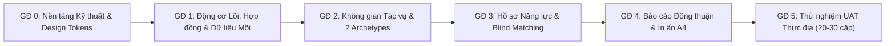

# KẾ HOẠCH THỰC HIỆN THEO GIAI ĐOẠN (PHASED IMPLEMENTATION PLAN)
**Dự án:** LucidTask — Nền tảng Hướng nghiệp & Trải nghiệm Tác vụ Thực chứng  
**Căn cứ lập kế hoạch:** Toàn bộ hệ thống đặc tả trong thư mục [specs/](file:///Users/phamkhanh/Documents/2026.1/DMST/LucidTask/specs)  
**Quy chuẩn thực thi:** Mọi công việc/giai đoạn phải minh bạch 100% **Tài liệu & Dữ liệu Đầu vào** và **Sản phẩm & Tiêu chí Đầu ra** trước khi thực thi.  
**Phiên bản:** 2.0 (Full Input-Output Specification Matrix)  

---

## 1. Tổng Quan Lộ Trình 5 Giai Đoạn (Milestone Roadmap)



---

## 2. Quy Chuẩn Đầu Vào – Đầu Ra Cho Từng Giai Đoạn

---

### GIAI ĐOẠN 0: Khởi Tạo Nền Tảng Kỹ Thuật & Design Tokens (Sprint 0)

#### 1. Tài liệu & Dữ liệu Đầu vào (Inputs)
- **Tài liệu đặc tả bắt buộc đọc:**
  - [.AGENTS/DESIGN.md](file:///Users/phamkhanh/Documents/2026.1/DMST/LucidTask/.AGENTS/DESIGN.md): Đọc toàn bộ quy tắc thiết kế Al Jazeera Editorial Hard-News Console, bảng mã màu gốc (`#fa9000`, `#c31833`, `#100e2f`, `#d8d8d8`, `#ffffff`, `#f9f9f9`), typography (font Roboto, không dùng sans-serif mặc định), quy cách pill button (`rounded-lg` 18px, active:scale-[0.98]) và triết lý Zero Elevation (không dùng drop-shadow).
  - [specs/SOFTWARE_DESIGN_DOCUMENT.md](file:///Users/phamkhanh/Documents/2026.1/DMST/LucidTask/specs/SOFTWARE_DESIGN_DOCUMENT.md): Đọc Mục 1 (Kiến trúc Tổng thể & Công nghệ) và Mục 2 (Cấu trúc thư mục mã nguồn).
  - [specs/UI_UX_Wireframe_Spec.md](file:///Users/phamkhanh/Documents/2026.1/DMST/LucidTask/specs/UI_UX_Wireframe_Spec.md): Đọc Mục 1 (Bảng Design Tokens Tham chiếu) và Mục 5 (Đặc tả CSS Cho Khổ Giấy In A4).
- **Trạng thái & Môi trường đầu vào (Preconditions):**
  - Git repository sạch sẽ, nhánh `main`.
  - Node.js v22+, npm v10+.

#### 2. Các bước thực hiện (Tasks)
1. Khởi tạo cấu hình cấu trúc dự án: `package.json`, `tsconfig.json`, `vite.config.ts`, `postcss.config.js`.
2. Cài đặt các thư viện lõi: `react`, `react-dom`, `lucide-react`, `canvas-confetti`, `@types/canvas-confetti`.
3. Cài đặt môi trường kiểm thử: `vitest`, `@testing-library/react`, `@testing-library/jest-dom`, `jsdom`.
4. Cấu hình `tailwind.config.js` ánh xạ chính xác 100% token từ `.AGENTS/DESIGN.md`.
5. Tạo `index.html` tải font Google Fonts `Roboto` (300, 400, 700, 900).
6. Viết `src/index.css` với các class tiện ích: `.btn-pill-dark`, `.btn-pill-outline`, `.eyebrow-marker`, `.badge-live-red` và `@media print`.
7. Tạo file cấu hình test `tests/setup.ts`.

#### 3. Sản phẩm Đầu ra (Outputs & Deliverables)
- `package.json`, `package-lock.json`
- `tsconfig.json`, `tsconfig.node.json`
- `vite.config.ts` (kèm cấu hình coverage filter)
- `tailwind.config.js`, `postcss.config.js`
- `index.html`
- `src/index.css`
- `tests/setup.ts`
- `src/App.tsx`, `src/main.tsx` (khung placeholder tối giản)

#### 4. Cổng Nghiệm thu (Quality Gate 0)
- Lệnh kiểm tra: `npm run type-check && npm run build && npm test`.
- Tiêu chí:
  - TypeScript biên dịch không lỗi (0 error).
  - Bundle build thành công.
  - Vitest khởi động và kết thúc sạch sẽ.

---

### GIAI ĐOẠN 1: Động Cơ Lõi, Hợp Đồng Dữ Liệu & Registry (Sprint 1)

#### 1. Tài liệu & Dữ liệu Đầu vào (Inputs)
- **Tài liệu đặc tả bắt buộc đọc:**
  - [specs/Data_Schema_&_Seed_Data.md](file:///Users/phamkhanh/Documents/2026.1/DMST/LucidTask/specs/Data_Schema_&_Seed_Data.md): Đọc Mục 1 (TypeScript Interfaces) và Mục 2 (Dữ liệu mẫu 8 chương trình đào tạo & dữ liệu rủi ro thị trường).
  - [specs/Scenario_&_Scoring_Spec.md](file:///Users/phamkhanh/Documents/2026.1/DMST/LucidTask/specs/Scenario_&_Scoring_Spec.md): Đọc Mục 2 (Từ điển Sự kiện Telemetry), Mục 3 (Công thức toán học 3 trục năng lực: $S_{\text{Logic}}, S_{\text{Patience}}, S_{\text{Resilience}}$), Mục 4 (Công thức Cosine Similarity & Phạt lệch trục).
  - [specs/QA_TEST_PLAN.md](file:///Users/phamkhanh/Documents/2026.1/DMST/LucidTask/specs/QA_TEST_PLAN.md): Đọc Mục 3 (Ma trận Ca kiểm thử Đơn vị: `UT-SCORE-01`, `UT-SCORE-02`, `UT-COSINE-01`, `UT-COSINE-02`, `UT-GATE-01`, `UT-GATE-02`, `UT-GATE-03`, `UT-BUS-01`).
  - [specs/AI_DLC_Eval_&_Data_Feasibility_Spec.md](file:///Users/phamkhanh/Documents/2026.1/DMST/LucidTask/specs/AI_DLC_Eval_&_Data_Feasibility_Spec.md): Đọc Mục 2 (Ground Truth & Tiêu chuẩn chấp nhận: Độ trễ $\le 50$ms, NDCG@3 $\ge 0.85$).
- **Trạng thái đầu vào (Preconditions):**
  - Giai đoạn 0 đã hoàn thành và đạt Quality Gate 0.

#### 2. Các bước thực hiện (Tasks)
1. Xây dựng hợp đồng dữ liệu tại `src/types/`: `task.ts`, `program.ts`, `telemetry.ts`, `state.ts`.
2. Tạo dữ liệu mẫu tại `src/registry/software_engineering/`: `stage1_task.json`, `stage2_task.json`, `programs.json`, `industry.json`.
3. Xây dựng trình nạp động `src/registry/index.ts`.
4. Phát triển `src/engine/TelemetryBus.ts`: Hệ thống pub/sub thu thập micro-events với độ trễ $< 50$ms.
5. Phát triển `src/engine/ScoringEngine.ts`:
   - Hàm `evaluateStage1Gatekeeper(events, timeSpentSeconds)`.
   - Hàm `computeCompetencyProfile(events, stage1Summary, stage2Summary)`.
   - Hàm `computeCosineMatch(userVector, programVector, weights)`.
   - Hàm `rankPrograms(userVector, programs)`.
6. Xây dựng bộ Unit Test tự động bao phủ toàn bộ ma trận `QA_TEST_PLAN.md`.

#### 3. Sản phẩm Đầu ra (Outputs & Deliverables)
- `src/types/task.ts`, `src/types/program.ts`, `src/types/telemetry.ts`, `src/types/state.ts`
- `src/registry/software_engineering/stage1_task.json`
- `src/registry/software_engineering/stage2_task.json`
- `src/registry/software_engineering/programs.json`
- `src/registry/software_engineering/industry.json`
- `src/registry/index.ts`
- `src/engine/TelemetryBus.ts`
- `src/engine/ScoringEngine.ts`
- `tests/unit/scoring.test.ts`
- `tests/unit/matching.test.ts`
- `tests/unit/gatekeeper.test.ts`
- `tests/unit/telemetryBus.test.ts`

#### 4. Cổng Nghiệm thu (Quality Gate 1)
- Lệnh kiểm tra: `npm test && npm run test:coverage`.
- Tiêu chí:
  - 100% test cases trong `tests/unit/` PASS.
  - Line Coverage cho `src/engine/` đạt $\ge 80\%$ (kỳ vọng $\ge 95\%$).
  - Thuật toán Cosine trả về đúng thứ tự ranking đối chiếu với Ground Truth trong `AI_DLC_Eval_&_Data_Feasibility_Spec.md`.

---

### GIAI ĐOẠN 2: Không Gian Tác Vụ & 2 Archetypes Tương Tác (Sprint 2)

#### 1. Tài liệu & Dữ liệu Đầu vào (Inputs)
- **Tài liệu đặc tả bắt buộc đọc:**
  - [specs/Task_Engine_Architecture.md](file:///Users/phamkhanh/Documents/2026.1/DMST/LucidTask/specs/Task_Engine_Architecture.md): Đọc Mục 2 (4 Universal Interaction Archetypes: Archetype 1 - Triage & Classify, Archetype 3 - Multi-Source Investigation).
  - [specs/UI_UX_Wireframe_Spec.md](file:///Users/phamkhanh/Documents/2026.1/DMST/LucidTask/specs/UI_UX_Wireframe_Spec.md): Đọc Mục 2 (Màn hình 1 - Không gian Tác vụ Thực chứng: Stepper, Live HUD, Handbook Slide-out Drawer, Stress timer indicator $\le 60$s) và Mục 4 (Màn hình Dừng Sớm Early Exit).
  - [specs/SRS.md](file:///Users/phamkhanh/Documents/2026.1/DMST/LucidTask/specs/SRS.md): Đọc `FR-01` (Lựa chọn ngành nghề), `FR-02` (Không gian mô phỏng tác vụ), `FR-03` (Bộ lọc sàng lọc sớm Gatekeeper), `FR-04` (Sổ tay nghiệp vụ Handbook).
  - [.AGENTS/DESIGN.md](file:///Users/phamkhanh/Documents/2026.1/DMST/LucidTask/.AGENTS/DESIGN.md): Quy chuẩn thanh console tối màu `#100e2f`, logo block `#fa9000`, thẻ trắng viền hairline `#d8d8d8`.
- **Trạng thái đầu vào (Preconditions):**
  - Giai đoạn 1 đã hoàn thành và đạt Quality Gate 1 (Động cơ và Registry sẵn sàng).

#### 2. Các bước thực hiện (Tasks)
1. Xây dựng khung ứng dụng `src/components/AppShell.tsx`: Navigation bar hard-news `#100e2f`, telemetry live indicator.
2. Xây dựng `src/components/IndustrySelector.tsx`: Giao diện giới thiệu ngành và lộ trình trải nghiệm 2 chặng.
3. Xây dựng `src/components/TaskWorkspace.tsx`:
   - Thanh tiến trình Stepper (Chặng 1 $\rightarrow$ Chặng 2).
   - Đồng hồ đếm ngược với hiệu ứng chuyển viền đỏ `#c31833` khi thời gian còn $\le 60$ giây.
   - Sổ tay Drawer (`HandbookDrawer`) trượt ra từ lề phải hỗ trợ tra cứu quy tắc.
4. Xây dựng 2 Archetypes tương tác:
   - `src/components/archetypes/TriageClassifier.tsx` (Archetype 1: phân loại ticket lỗi vào thùng Kết nối mạng vs Lỗi dữ liệu).
   - `src/components/archetypes/MultiSourceInspector.tsx` (Archetype 3: đối soát 3 tab nhật ký hệ thống, server metric, commit log và ra quyết định Rollback).
5. Xây dựng `src/components/EarlyExitScreen.tsx`: Màn hình dừng sớm hiển thị la bàn tư vấn khi học sinh click ẩu.
6. Viết Integration Test cho luồng tác vụ và Early Exit.

#### 3. Sản phẩm Đầu ra (Outputs & Deliverables)
- `src/components/AppShell.tsx`
- `src/components/IndustrySelector.tsx`
- `src/components/TaskWorkspace.tsx`
- `src/components/HandbookDrawer.tsx`
- `src/components/archetypes/TriageClassifier.tsx`
- `src/components/archetypes/MultiSourceInspector.tsx`
- `src/components/EarlyExitScreen.tsx`
- `tests/integration/workspace.test.tsx` (`IT-WORK-01`, `IT-WORK-02`)

#### 4. Cổng Nghiệm thu (Quality Gate 2)
- Lệnh kiểm tra: `npm test tests/integration/workspace.test.tsx`.
- Tiêu chí:
  - Khi học sinh thao tác ẩu (< 1.2s/thao tác hoặc độ chính xác < 60%), hệ thống ngắt tác vụ và kích hoạt `EarlyExitScreen` trước mốc 90s.
  - Khi học sinh đạt chuẩn, tác vụ chuyển tiếp mượt mà từ Chặng 1 sang Chặng 2 trong $\le 1$ giây.

---

### GIAI ĐOẠN 3: Hồ Sơ Năng Lực & Khung Ghép Nối Ẩn Danh (Sprint 3)

#### 1. Tài liệu & Dữ liệu Đầu vào (Inputs)
- **Tài liệu đặc tả bắt buộc đọc:**
  - [specs/UI_UX_Wireframe_Spec.md](file:///Users/phamkhanh/Documents/2026.1/DMST/LucidTask/specs/UI_UX_Wireframe_Spec.md): Đọc Mục 3 (Màn hình 2 - Bảng Ghép Nối Ẩn Danh & Hồ Sơ Năng Lực).
  - [specs/SRS.md](file:///Users/phamkhanh/Documents/2026.1/DMST/LucidTask/specs/SRS.md): Đọc `FR-05` (Hồ sơ năng lực 3 trục), `FR-06` (Ghép nối chương trình ẩn danh & Mở khóa thực chứng).
  - [specs/QA_TEST_PLAN.md](file:///Users/phamkhanh/Documents/2026.1/DMST/LucidTask/specs/QA_TEST_PLAN.md): Đọc `IT-BLIND-01` (Invariant: Tên trường đại học thật tuyệt đối không được render vào DOM ở bất kỳ thẻ hay thuộc tính ẩn nào trước khi nhấn Unlock).
  - [specs/SOFTWARE_DESIGN_DOCUMENT.md](file:///Users/phamkhanh/Documents/2026.1/DMST/LucidTask/specs/SOFTWARE_DESIGN_DOCUMENT.md): Đọc Mục 4.2 (Biểu đồ tuần tự Sequence Diagram Luồng Ghép Nối Ẩn Danh & Mở Khóa).
- **Trạng thái đầu vào (Preconditions):**
  - Giai đoạn 2 đã hoàn thành và đạt Quality Gate 2.

#### 2. Các bước thực hiện (Tasks)
1. Xây dựng `src/components/CompetencyRadar.tsx`:
   - 3 thước đo trực quan: Tư duy Logic (Cam `#fa9000`), Độ kiên nhẫn (Xanh lá), Sức bền giờ G (Đỏ `#c31833`).
   - 2 nhận định định tính dựa trên chuỗi telemetry thực tế.
2. Xây dựng `src/components/BlindMatchingCards.tsx`:
   - Giao diện che thương hiệu: chỉ hiển thị mã ẩn danh (Chương trình Alpha, Beta, Gamma...), % tương thích, 3 môn đồ án cốt lõi và dải lương.
   - Nút Black Pill `[MỞ KHÓA DANH TÍNH CƠ SỞ ĐÀO TẠO]`.
   - Tích hợp hiệu ứng pháo hoa `canvas-confetti` khi người dùng kích hoạt mở khóa.
   - Sau khi mở khóa: Tên trường thật, học phí, tỷ lệ việc làm và chứng nhận mới được inject vào DOM.
3. Viết kiểm thử bất biến DOM `tests/integration/blindMatching.test.tsx` (`IT-BLIND-01`, `IT-REVEAL-01`).

#### 3. Sản phẩm Đầu ra (Outputs & Deliverables)
- `src/components/CompetencyRadar.tsx`
- `src/components/BlindMatchingCards.tsx`
- `tests/integration/blindMatching.test.tsx`

#### 4. Cổng Nghiệm thu (Quality Gate 3)
- Lệnh kiểm tra: `npm test tests/integration/blindMatching.test.tsx`.
- Tiêu chí:
  - Test `IT-BLIND-01` PASS: Quét `document.body.innerHTML` không chứa bất kỳ chuỗi tên trường thật nào (như "Bách Khoa", "FPT", "RMIT"...) trước sự kiện Reveal.
  - Test `IT-REVEAL-01` PASS: Sau khi click Unlock, tên trường được hiển thị đầy đủ và chính xác theo dữ liệu ghép nối.

---

### GIAI ĐOẠN 4: Báo Cáo Đồng Thuận Gia Đình & Tối Ưu In Khổ A4 (Sprint 4)

#### 1. Tài liệu & Dữ liệu Đầu vào (Inputs)
- **Tài liệu đặc tả bắt buộc đọc:**
  - [specs/UI_UX_Wireframe_Spec.md](file:///Users/phamkhanh/Documents/2026.1/DMST/LucidTask/specs/UI_UX_Wireframe_Spec.md): Đọc Mục 4 (Màn hình 3 - Báo Cáo Đồng Thuận Phụ Huynh) và Mục 5 (Đặc tả CSS Cho Khổ Giấy In A4 `@media print`).
  - [specs/SRS.md](file:///Users/phamkhanh/Documents/2026.1/DMST/LucidTask/specs/SRS.md): Đọc `FR-07` (Báo cáo đồng thuận phụ huynh 2 cột), `FR-08` (Bộ câu hỏi gợi mở thảo luận bữa tối), `FR-09` (Xuất báo cáo bản in PDF/A4), `NFR-04` (Khả năng in ấn chuẩn xác).
  - [specs/Data_Schema_&_Seed_Data.md](file:///Users/phamkhanh/Documents/2026.1/DMST/LucidTask/specs/Data_Schema_&_Seed_Data.md): Đọc bảng tính chi phí lãng phí 185.000.000 VNĐ khi chọn sai ngành.
- **Trạng thái đầu vào (Preconditions):**
  - Giai đoạn 3 đã hoàn thành và đạt Quality Gate 3.

#### 2. Các bước thực hiện (Tasks)
1. Xây dựng `src/components/ParentAlignmentKit.tsx`:
   - Cột 1 (Dữ liệu học sinh): Điểm 3 trục năng lực, minh chứng thao tác chi tiết (thời gian tra sổ tay, số lần đối soát).
   - Cột 2 (Dữ liệu thị trường): Dải lương 5 năm, nguy cơ tự động hóa bởi AI, cảnh báo chi phí chìm 185.000.000 VNĐ.
   - Vùng Đồng Thuận (Alignment Zone): 3 câu hỏi bàn ăn gia đình được gợi mở theo điểm yếu/mạnh của học sinh.
   - Nút in `[IN BÁO CÁO A4 (PDF)]` gọi `window.print()`.
2. Tinh chỉnh `src/index.css`: Căn lề `@page { size: A4 portrait; margin: 10mm; }`, ẩn toàn bộ navbar và các nút hành động khi in.
3. Ghép nối luồng hoàn chỉnh vào `src/App.tsx`.
4. Viết integration test cho toàn bộ luồng E2E từ chọn ngành $\rightarrow$ làm task $\rightarrow$ xem matching $\rightarrow$ xuất báo cáo.

#### 3. Sản phẩm Đầu ra (Outputs & Deliverables)
- `src/components/ParentAlignmentKit.tsx`
- `src/App.tsx` (hoàn thiện toàn bộ state machine)
- `tests/integration/e2eFlow.test.tsx`

#### 4. Cổng Nghiệm thu (Quality Gate 4)
- Lệnh kiểm tra: `npm test && npm run build`.
- Tiêu chí:
  - Toàn bộ suite test (Unit + Integration) chạy PASS 100%.
  - Layout in ấn hiển thị gọn trong 1 trang A4 chuẩn (hoặc tối đa 2 trang liền mạch không bị cắt chữ).

---

### GIAI ĐOẠN 5: Thử Nghiệm Pilot & Thực Địa ĐMST (Sprint 5)

#### 1. Tài liệu & Dữ liệu Đầu vào (Inputs)
- **Tài liệu đặc tả bắt buộc đọc:**
  - [specs/Validation_Plan.md](file:///Users/phamkhanh/Documents/2026.1/DMST/LucidTask/specs/Validation_Plan.md): Đọc toàn bộ quy trình thực nghiệm (Pilot N=5, Nghiên cứu chính N=20–30 cặp), bảng câu hỏi Pre-test/Post-test, biên bản quan sát thực địa [Observation Log Sheet](file:///Users/phamkhanh/Documents/2026.1/DMST/LucidTask/specs/Validation_Plan.md#L45-L65).
  - [specs/AI_DLC_Eval_&_Data_Feasibility_Spec.md](file:///Users/phamkhanh/Documents/2026.1/DMST/LucidTask/specs/AI_DLC_Eval_&_Data_Feasibility_Spec.md): Đọc Mục 4 (Khung 4 Tầng Giảm Thiểu Thiên Vị).
- **Trạng thái đầu vào (Preconditions):**
  - Giai đoạn 4 đã hoàn thành và hệ thống đã được triển khai live trên môi trường Staging/Production (Vercel).

#### 2. Các bước thực hiện (Tasks)
1. Thử nghiệm Pilot nội bộ (N = 5 học sinh):
   - Đánh giá khả năng hiểu đề bài, thời gian đọc sổ tay Handbook.
   - Căn chỉnh ngưỡng độ nhạy của bộ lọc Early Exit.
2. Triển khai thực địa chính thức (N = 20–30 cặp học sinh & phụ huynh):
   - Bước 1: Khảo sát định kiến trước trải nghiệm (Pre-test).
   - Bước 2: Quan sát học sinh làm bài không can thiệp (Silent Observation).
   - Bước 3: Xem kết quả Blind Matching & mở khóa Reveal cùng phụ huynh.
   - Bước 4: Phỏng vấn sâu cặp phụ huynh - học sinh với Báo cáo Đồng thuận.
3. Thu thập và đối chiếu số liệu theo 4 Giả thuyết Nghiên cứu:
   - $H_0$: $\ge 75\%$ học sinh bị dừng sớm đồng ý với kết luận.
   - $H_1$: $\ge 40\%$ học sinh chọn trường khác ngoài danh sách ban đầu sau khi mở khóa.
   - $H_2$: $\ge 80\%$ người tham gia tin tưởng điểm số đo bằng tác vụ hơn khảo sát trắc nghiệm.
   - $H_3$: $\ge 70\%$ phụ huynh thay đổi góc nhìn về chọn ngành/trường cho con sau khi đọc báo cáo.

#### 3. Sản phẩm Đầu ra (Outputs & Deliverables)
- Bộ dữ liệu thực nghiệm điền sẵn: `docs/validation/OBSERVATION_LOGS.csv`.
- Báo cáo phân tích kết quả định lượng và định tính: `docs/validation/FIELD_VALIDATION_REPORT.md`.
- Trích đoạn phỏng vấn mẫu sẵn sàng đưa vào Chương 4 & 5 Báo cáo Môn học ĐMST.

#### 4. Cổng Nghiệm thu (Quality Gate 5)
- Bộ số liệu thực địa hoàn chỉnh, tỷ lệ đạt các ngưỡng $H_0, H_1, H_2, H_3$ được xác thực phục vụ nghiệm thu đồ án môn học.

---

## 3. Ma Trận Tóm Tắt Đầu Vào – Đầu Ra Liên Hoàn

```
┌────────────────────────────────────────────────────────────────────────┐
│ GIAI ĐOẠN 0: SCAFFOLDING & DESIGN TOKENS                               │
│  [IN]  .AGENTS/DESIGN.md, SDD.md, UI_UX_Wireframe_Spec.md              │
│  [OUT] package.json, vite.config.ts, tailwind.config.js, index.css     │
│  [GATE] npm run build && npm test (PASS)                               │
└───────────────────────────────────┬────────────────────────────────────┘
                                    │ (Nền tảng build & test sẵn sàng)
                                    ▼
┌────────────────────────────────────────────────────────────────────────┐
│ GIAI ĐOẠN 1: CORE ENGINE & SEED DATA REGISTRY                          │
│  [IN]  Data_Schema_&_Seed_Data.md, Scenario_&_Scoring_Spec.md, QA_PLAN │
│  [OUT] src/types/*, src/registry/*, TelemetryBus.ts, ScoringEngine.ts   │
│  [GATE] Unit tests pass 100%, Coverage >= 80%                          │
└───────────────────────────────────┬────────────────────────────────────┘
                                    │ (Động cơ toán học & dữ liệu sẵn sàng)
                                    ▼
┌────────────────────────────────────────────────────────────────────────┐
│ GIAI ĐOẠN 2: WORKSPACE & 2 INTERACTION ARCHETYPES                      │
│  [IN]  Task_Engine_Architecture.md, UI_UX_Wireframe_Spec.md (Màn 1)    │
│  [OUT] AppShell, IndustrySelector, TaskWorkspace, 2 Archetypes, Exit   │
│  [GATE] Thao tác ẩu kích hoạt Early Exit; Chuyển chặng mượt mà         │
└───────────────────────────────────┬────────────────────────────────────┘
                                    │ (Luồng làm bài & ghi telemetry sẵn sàng)
                                    ▼
┌────────────────────────────────────────────────────────────────────────┐
│ GIAI ĐOẠN 3: COMPETENCY PROFILE & BLIND MATCHING                       │
│  [IN]  UI_UX_Wireframe_Spec.md (Màn 2), AI_DLC_Eval_Spec.md            │
│  [OUT] CompetencyRadar, BlindMatchingCards (DOM isolation, Confetti)   │
│  [GATE] Test IT-BLIND-01 pass (Zero leakage tên trường trong DOM)      │
└───────────────────────────────────┬────────────────────────────────────┘
                                    │ (Hồ sơ năng lực & trường ghép nối sẵn sàng)
                                    ▼
┌────────────────────────────────────────────────────────────────────────┐
│ GIAI ĐOẠN 4: PARENT ALIGNMENT KIT & A4 PRINT EXPORT                    │
│  [IN]  UI_UX_Wireframe_Spec.md (Màn 3, CSS Print), SRS.md (FR-07..09)  │
│  [OUT] ParentAlignmentKit, E2E App flow, CSS @media print A4           │
│  [GATE] Xuất PDF đúng 1 trang A4 portrait không lỗi font, E2E Pass     │
└───────────────────────────────────┬────────────────────────────────────┘
                                    │ (Sản phẩm phần mềm hoàn thiện)
                                    ▼
┌────────────────────────────────────────────────────────────────────────┐
│ GIAI ĐOẠN 5: FIELD VALIDATION & UAT (N = 20-30 CẶP)                    │
│  [IN]  Validation_Plan.md (Quy trình 4 bước, phiếu khảo sát)           │
│  [OUT] FIELD_VALIDATION_REPORT.md, Dữ liệu thực nghiệm H0 -> H3        │
│  [GATE] Nghiệm thu dữ liệu thực chứng cho đồ án môn học ĐMST           │
└────────────────────────────────────────────────────────────────────────┘
```
