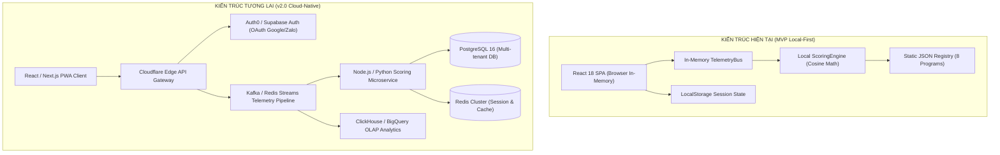

# LỘ TRÌNH TIẾN HÓA KIẾN TRÚC HỆ THỐNG (ARCHITECTURE EVOLUTION ROADMAP)
**Dự án:** LucidTask — Nền tảng Hướng nghiệp & Trải nghiệm Tác vụ Thực chứng  
**Phiên bản định hướng:** Cloud-Native & Scalable Platform (v2.0+)  
**Mục tiêu:** Chuyển đổi từ mô hình *Client-side Local-First (MVP)* sang kiến trúc *Cloud-Native Distributed Platform* phục vụ đồng thời hàng chục nghìn người dùng trên toàn quốc.

---

## 1. Sơ Đồ Chuyển Đổi Kiến Trúc: MVP vs. Production v2.0

---

## 2. Các Trụ Cột Nâng Cấp Công Nghệ Cốt Lõi

### 2.1. Quản Lý Danh Tính & Phân Quyền Đa Tầng (Auth & RBAC)
*Hiện tại:* Không yêu cầu đăng nhập, mỗi học sinh là một Guest Session.  
*Nâng cấp v2.0:*
- Tích hợp đăng nhập một chạm qua **Google OAuth** và **Zalo Login** (phổ biến nhất với phụ huynh Việt Nam).
- Phân quyền 3 vai trò (Role-Based Access Control):
  1. `ROLE_STUDENT`: Tham gia thử thách, lưu trữ lịch sử qua nhiều năm cấp 3, theo dõi sự thay đổi năng lực.
  2. `ROLE_PARENT`: Đọc báo cáo đồng thuận, đặt lịch tư vấn, tham gia cộng đồng cha mẹ đồng hành.
  3. `ROLE_UNIVERSITY_ADMIN`: Đăng tải chỉ tiêu, xem báo cáo xu hướng năng lực thí sinh, gửi thư mời học bổng.

---

### 2.2. Cơ Sở Dữ Liệu Đám Mây & Bền Vững Hóa Trạng Thái (Database & Persistence)
*Hiện tại:* `localStorage` trên trình duyệt máy tính.  
*Nâng cấp v2.0:*
- Sử dụng **PostgreSQL 16** với các bảng chuẩn hóa theo ERD trong `SOFTWARE_DESIGN_DOCUMENT.md`.
- Sử dụng **Prisma ORM** hoặc **Drizzle ORM** để đảm bảo Typescript end-to-end type safety từ Database lên Client.
- Đồng bộ đa thiết bị: Học sinh làm bài trên máy tính ở trường THPT $\rightarrow$ Phụ huynh có thể mở điện thoại ở nhà quét mã QR xem ngay kết quả thời gian thực.

---

### 2.3. Trục Thu Thập Sự Kiện Đám Mây & Phân Tích Lớn (Telemetry Stream & Big Data)
*Hiện tại:* In-memory pub/sub ghi nhận tối đa vài trăm sự kiện chuột mỗi phiên.  
*Nâng cấp v2.0:*
- Đóng gói chuỗi telemetry vi thao tác và đẩy ngầm qua **WebSocket / Server-Sent Events** về **Redis Streams**.
- Lưu trữ lịch sử hành vi vào **ClickHouse** hoặc **Google BigQuery** để phục vụ các bài toán nghiên cứu hành vi người học trên quy mô lớn (Educational Data Mining).

---

### 2.4. Tối Ưu Hóa Trải Nghiệm Thiết Bị Di Động (Mobile-First & PWA)
*Hiện tại:* Giao diện tối ưu cho màn hình Laptop/Desktop ($\ge 1280$px) để học sinh giải quyết sự cố như kỹ sư thật.  
*Nâng cấp v2.0:*
- Xây dựng bản **Progressive Web App (PWA)**:
  - Cho phép phụ huynh đọc Báo cáo Đồng thuận mượt mà trên iPhone/Android.
  - Cho phép học sinh nhận thông báo đẩy (Push Notifications) khi các trường đại học công bố học bổng hoặc mở ngày hội trải nghiệm (Open Day).
