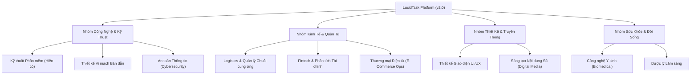

# LỘ TRÌNH MỞ RỘNG TÍNH NĂNG (POST-MVP PRODUCT ROADMAP)
**Dự án:** LucidTask — Nền tảng Hướng nghiệp & Trải nghiệm Tác vụ Thực chứng  
**Phiên bản định hướng:** v2.0 & Commercial Edition  
**Mục tiêu:** Mở rộng từ 1 cụm ngành thí điểm (CNTT / QA) sang hệ sinh thái hướng nghiệp toàn diện 20+ cụm ngành nghề, tích hợp cổng thông tin đại học B2B và sàn tác vụ tương tác.

---

## 1. Mở Rộng Hệ Sinh Thái Ngành Nghề (Multi-Industry Catalog)

Phiên bản MVP tập trung vào ngành *Kỹ thuật Phần mềm / QA*. Trong các giai đoạn tiếp theo, hệ thống sẽ mở rộng theo 4 nhóm ngành kinh tế trọng điểm:

### Chi tiết các cụm ngành ưu tiên triển khai kế tiếp:
1. **Cụm Logistics & Chuỗi Cung Ứng (Supply Chain Management):**
   - *Task 1 (90s):* Đối soát vận đơn và phân loại mã hải quan (Sơ tuyển ma sát).
   - *Task 2 (3.5 min):* Phân bổ tải trọng container, giải quyết bài toán giao hàng giờ cao điểm khi tắc cảng Cát Lái (Archetype 2: Constrained Resource Allocation).
2. **Cụm Thiết Kế Vi Mạch Bán Dẫn (Semiconductor IC Design):**
   - *Task 1 (90s):* Kiểm tra lỗi bố trí chân chip (Pinout routing check).
   - *Task 2 (3.5 min):* Tối ưu hóa đường dây tín hiệu clock và kiểm soát rò rỉ nhiệt trên bảng mạch 7nm.
3. **Cụm Tài Chính & Phân Tích Định Lượng (Fintech & Quant Analytics):**
   - *Task 1 (90s):* Phân loại giao dịch gian lận thẻ tín dụng.
   - *Task 2 (3.5 min):* Tái cân bằng danh mục đầu tư dưới biến động thị trường chứng khoán (Archetype 4: Trade-off Prioritization).

---

## 2. Hệ Thống Quản Trị Nội Dung Tác Vụ (Task Authoring CMS)
*Hiện tại:* Đề bài và cấu hình task được lập trình viên viết trực tiếp vào file JSON trong `src/registry/`.  
*Tương lai (v2.0):*
- Cung cấp giao diện đồ họa **Task Studio No-Code / Low-Code** dành cho giảng viên các trường Đại học và chuyên gia doanh nghiệp.
- Cho phép giảng viên kéo thả tạo các màn hình thử thách: định nghĩa luật trong sổ tay Handbook, tạo bảng dữ liệu đối soát và gắn thẻ chấm điểm năng lực.

---

## 3. Cổng Kết Nối Cơ Sở Đào Tạo (B2B University Admissions Portal)
*Hiện tại:* Dữ liệu 8 chương trình đào tạo là dữ liệu mẫu tĩnh.  
*Tương lai (v2.0):*
- Cung cấp cổng thông tin tự quản trị cho các trường Đại học (Bách Khoa, RMIT, FPT, UEH, Cao Thắng...):
  - Cập nhật chỉ tiêu, học phí và điểm sàn tuyển sinh theo thời gian thực.
  - Nhận hồ sơ năng lực thực chứng (ẩn danh) của các học sinh có độ tương thích cao ($\ge 85\%$) để chủ động cấp học bổng tài năng hoặc thư mời trải nghiệm mở rộng.

---

## 4. Báo Cáo Tương Tác Trực Tuyến & Cố Vấn 1-1 (Interactive Mentorship Hub)
- Thay vì chỉ in file PDF, phụ huynh và học sinh có thể:
  - Tạo link chia sẻ báo cáo bảo mật qua Zalo/Email cho người thân.
  - Đặt lịch hẹn cố vấn 1-1 trực tiếp với các cựu sinh viên đang làm nghề hoặc chuyên gia tuyển sinh của trường đại học được ghép nối.
