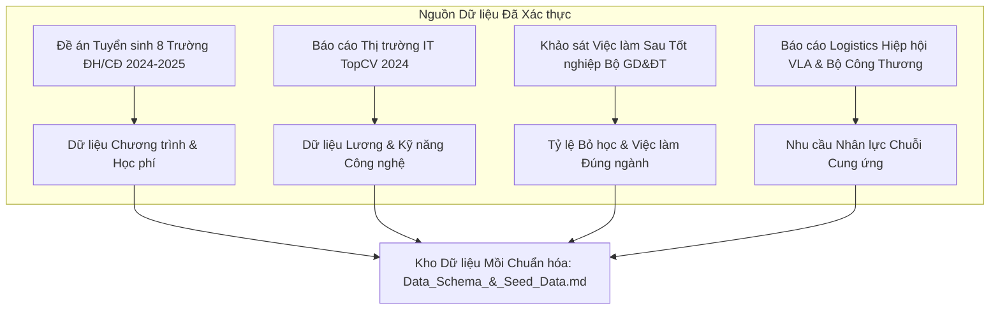

# ĐẶC TẢ KIỂM CHỨNG AI-DLC: TIÊU CHÍ ĐÁNH GIÁ & TÍNH KHẢ THI DỮ LIỆU
**Tài liệu:** AI_DLC_Eval_&_Data_Feasibility_Spec.md  
**Dự án:** LucidTask — Nền tảng Hướng nghiệp & Trải nghiệm Tác vụ Thực chứng  
**Mục tiêu:** Đáp ứng trọn vẹn 3 nguyên lý sống còn của vòng đời phát triển phần mềm định hướng AI (AI-Driven Software Development Life Cycle — AI-DLC):
1. **Spec-as-Source (Đặc tả là Mã nguồn qua khung CRAFT)**
2. **Specs become Eval Criteria (Ground Truth & Chỉ số Đánh giá Đầu ra)**
3. **Data & Context Feasibility (Tính Khả thi, Khử Thiên vị & Kiểm soát Dữ liệu)**  
**Phiên bản:** 1.0  
**Tình trạng:** Khóa Quy chuẩn Kiểm chứng (Frozen Evaluation Baseline)  

---

## 1. TRỤ CỘT 1: ĐẶC TẢ LÀ MÃ NGUỒN (SPEC-AS-SOURCE QUA KHUNG CRAFT)

Để đảm bảo các AI Code Generation Agents (Gemini, Claude, Cursor) có thể đọc hiểu và trực tiếp sinh mã nguồn, kiến trúc component và unit test mà **không suy diễn sai lệch**, toàn bộ các tác vụ và module logic được cấu trúc hóa theo công thức **CRAFT**:

### 1.1. Khung CRAFT Mẫu cho Task 1 (Ngành Kỹ thuật Phần mềm — Sơ tuyển Log)
- **C (Context — Ngữ cảnh):** Ca trực xử lý sự cố trong đợt Mega-sale 12/12. Hệ thống đang chịu tải 10,000 req/s. Áp lực thời gian đếm ngược 90 giây. Người dùng là thực tập sinh mới vào ca trực.
- **R (Role — Vai trò):** `On-call Incident Analyst Junior`.
- **A (Action Space — Không gian Hành động Tuyệt đối Rời rạc):**
  Hệ thống chỉ chấp nhận 4 hành vi tương tác hợp lệ (Discrete Actions API):
  1. `ACTION_VIEW_HANDBOOK()`: Mở/đóng Drawer quy tắc.
  2. `ACTION_CLASSIFY(item_id: string, category: "CONN_ERR" | "DATA_ERR")`: Gắn nhãn phân loại.
  3. `ACTION_INSPECT_LOG(item_id: string)`: Bung chi tiết dòng log debug.
  4. `ACTION_SUBMIT()`: Kết thúc bài test sớm.
  *(Bất kỳ hành vi click nào ngoài tập này được ghi nhận vào `unregistered_clicks` để đo độ bồn chồn).*
- **F (Format — Định dạng Dữ liệu Bất biến):**
  Input và Output tuân thủ 100% TypeScript Schema định nghĩa tại [Data_Schema_&_Seed_Data.md](file:///Users/phamkhanh/Documents/2026.1/DMST/LucidTask/specs/Data_Schema_&_Seed_Data.md).
- **T (Target / Invariant Assertions — Ràng buộc Kiểm thử Bất biến):**
  - *Invariant-01:* `IF (correct_count / total_items) < 0.60 OR (total_time_spent / actions_count) < 1.2s THEN state MUST transition to EARLY_EXIT_SCREEN`.
  - *Invariant-02:* `IF state === "BLIND_MATCHING" THEN DOM MUST NOT CONTAIN any substring matching institution_name OR logo_url`.

---

## 2. TRỤ CỘT 2: ĐẶC TẢ LÀ TIÊU CHÍ ĐÁNH GIÁ (SPECS BECOME EVAL CRITERIA)

LucidTask kết hợp giữa **Logic Tất định (Deterministic Logic)** trong đo lường thao tác và **Thuật toán Khớp Mờ (Probabilistic / Vector Matching)** trong gợi ý chương trình học. Toàn bộ tiêu chí đánh giá đầu ra (Output Eval) và chuỗi hành vi (Trajectory Eval) được định lượng cụ thể:

### 2.1. Ma trận Ground Truth & Chỉ số Đánh giá Đầu ra (Output Eval Matrix)

| Module Chức năng | Dữ liệu Chuẩn Đối chiếu (Ground Truth) | Phương pháp Đánh giá (Eval Method) | Ngưỡng Chấp nhận Tối thiểu (Acceptance Threshold) |
| :--- | :--- | :--- | :--- |
| **Phân loại Tác vụ (Task Classification)** | Bộ nhãn chuẩn vàng (`correct_target_id`) do chuyên gia kỹ thuật phần mềm & logistics xác lập sẵn trong `seed_data.json`. | Exact Match (So khớp chính xác 1-1). | **$100\%$ tính tất định** (Không có độ trôi xác suất). |
| **Đo lường Hành vi (Telemetry Bus)** | Bảng dữ liệu định thời phần cứng trình duyệt (`performance.now()`). | Delta Latency Check. | Độ trễ ghi nhận sự kiện **$\le 50\text{ms}$**; Tần số làm mới đồng hồ **$1000\text{ms} \pm 20\text{ms}$**. |
| **Hồ sơ Năng lực (Competency Profiling)** | Bộ 10 Hồ sơ Mẫu Giả lập (Synthetic Benchmark Profiles) đại diện cho 3 nhóm tính cách: Cực kỳ cẩn trọng, Thao tác ẩu/đoán mò, Bền bỉ giờ G. | Sensitivity & Distance Analysis (Khoảng cách Euclidean giữa các nhóm). | Điểm năng lực 3 trục phải phân tách rõ rệt 3 nhóm người dùng với khoảng cách **$\Delta D \ge 0.35$**. |
| **So khớp Ẩn danh (Blind Matching Engine)** | Bảng đánh giá ghép trường của **3 Chuyên gia Hướng nghiệp Độc lập** trên 15 hồ sơ năng lực thực nghiệm. | Normalized Discounted Cumulative Gain (**NDCG@3**) & **Precision@3**. | • **NDCG@3 $\ge 0.85$**. • **Precision@3 $\ge 80.0\%$**. |
| **Lời khuyên Báo cáo Gia đình (Report Narrative Generator)** | Bộ khung mẫu slot-filling có kiểm soát (Constrained Slots) được duyệt bởi chuyên gia tâm lý học đường. | Semantic Consistency & Hallucination Check. | • **Tỷ lệ Ảo giác (Hallucination Rate): $0.0\%$**. • **Độ trễ sinh báo cáo: $\le 1.2\text{ giây}$**. • **Token Budget (nếu dùng LLM): $\le 350\text{ tokens/báo cáo}$**. |

### 2.2. Đánh giá Chuỗi Hành vi Thao tác (Trajectory Eval)
Hệ thống không chỉ chấm kết quả đúng/sai ở điểm cuối, mà đánh giá **đường đi thao tác (Interaction Trajectory)**:
- **Trajectory Hợp lệ (Good Path):** Đọc sổ tay $\ge 12$s $\rightarrow$ Xử lý từng thẻ với độ trễ $3\text{s} - 8\text{s}$ $\rightarrow$ Khi gặp lỗi mơ hồ bấm xem log debug $\rightarrow$ Giữ nhịp độ khi còn 60s.
- **Trajectory Bất thường (Anomaly Path):** Không đọc sổ tay ($<3$s) $\rightarrow$ Thao tác liên tiếp $<1.2$s/thẻ $\rightarrow$ Click loạn xạ vào màn hình $\rightarrow$ Kích hoạt cờ `EARLY_EXIT`.

---

## 3. TRỤ CỘT 3: TÍNH KHẢ THI DỮ LIỆU & NGỮ CẢNH (DATA & CONTEXT FEASIBILITY)

### 3.1. Nguồn Dữ liệu & Tính Sẵn có (Data Provenance & Availability)

Toàn bộ dữ liệu của LucidTask được kiểm chứng và truy xuất nguồn gốc minh bạch:

### 3.2. Chiến lược Khử Thiên vị Dữ liệu (De-biasing Strategies)

| Loại Thiên vị Tiềm ẩn (Bias) | Nguy cơ Sai lệch | Giải pháp Khử Thiên vị trong LucidTask |
| :--- | :--- | :--- |
| **Thiên vị Thương hiệu Trường (Brand Prestige Bias)** | Học sinh chọn trường vì tên tuổi, bỏ qua độ tương thích của chương trình đào tạo. | **Khử triệt để bằng Blind Matching:** Ẩn 100% tên trường, logo, địa chỉ cho đến khi học sinh chọn xong chương trình dựa trên năng lực và môn học thực chiến. |
| **Thiên vị Thao tác Nhanh (Gamer / Mechanical Dexterity Bias)** | Học sinh quen chơi game trên máy tính bấm chuột nhanh hơn học sinh ít dùng máy tính, dẫn đến kết luận sai về năng lực. | **Chuẩn hóa Đường cơ sở (Baseline Normalization):** Dành 15 giây đầu ở Chặng 1 để đo tốc độ cơ học bấm chuột của từng cá nhân, sau đó chỉ đo độ biến thiên vận tốc khi gặp tình huống phức tạp. |
| **Thiên vị Lương Đỉnh (Wage Outlier Bias)** | Dữ liệu tuyển dụng thường quảng bá các mức lương cá biệt (ví dụ: kỹ sư AI 50-70 triệu) gây ảo tưởng cho học sinh và phụ huynh. | **Dùng Dải Lương Trung vị (Median Range):** Phản ánh trung thực mức lương phổ biến của 80% sinh viên tốt nghiệp trong 0–2 năm đầu (10.5 – 18 triệu VNĐ). |
| **Thiên vị Giới tính trong Ngành Kỹ thuật (Gender Bias)** | Ngôn ngữ mô tả công việc IT/Logistics thường vô tình thiên về nam giới. | **Chuẩn hóa Ngôn từ Trung tính (Neutral Phrasing):** Tập trung 100% vào bản chất tư duy (tỉ mỉ, logic, gỡ lỗi), không sử dụng hình ảnh hay đại từ mang tính định kiến giới. |

### 3.3. Quy trình Chuẩn bị & Làm Sạch Dữ liệu (Data Preparation & Labeling Protocol)

Mọi kịch bản tác vụ và dữ liệu mồi trong hệ sinh thái LucidTask phải trải qua quy trình kiểm định 3 vòng nghiêm ngặt:
1. **Vòng 1 (Domain Expert Drafting):** Chuyên gia trong ngành (kỹ sư phần mềm, quản lý kho vận) soạn thảo tình huống dựa trên sự cố thực tế đã được lược bỏ thông tin mật.
2. **Vòng 2 (Pedagogical Filtering):** Giáo viên THPT và chuyên gia hướng nghiệp rà soát để loại bỏ toàn bộ thuật ngữ hàn lâm đại học, đảm bảo học sinh lớp 11–12 đọc hiểu dưới 20 giây.
3. **Vòng 3 (Student Pilot Testing):** Thử nghiệm pilot trên nhóm 5 học sinh để đo thời gian đọc trung bình và độ khó thực tế trước khi khóa dữ liệu vào `seed_data.json`.

