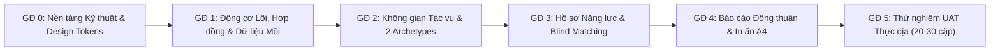

# KẾ HOẠCH THỰC HIỆN THEO GIAI ĐOẠN (PHASED IMPLEMENTATION PLAN)
**Dự án:** LucidTask — Nền tảng Hướng nghiệp & Trải nghiệm Tác vụ Thực chứng  
**Căn cứ lập kế hoạch:** Toàn bộ hệ thống đặc tả trong thư mục [specs/](file:///Users/phamkhanh/Documents/2026.1/DMST/LucidTask/specs)  
**Mô hình phát triển:** Agile / Sprints với Cổng Kiểm soát Chất lượng (Quality Gates & Definition of Done)  
**Phiên bản:** 1.0 (Master Execution Roadmap)  

---

## 1. Tổng Quan Lộ Trình 5 Giai Đoạn (Milestone Roadmap)

Lộ trình được chia làm 5 giai đoạn liên hoàn, mỗi giai đoạn giải quyết một tầng kiến trúc độc lập và chỉ được chuyển giai đoạn khi vượt qua bài kiểm tra nghiệm thu tương ứng:

---

## 2. Chi Tiết Từng Giai Đoạn Thực Hiện

### GIAI ĐOẠN 0: Khởi Tạo Nền Tảng Kỹ Thuật & Design Tokens (Sprint 0)
- **Mục tiêu:** Thiết lập khung sườn dự án (Scaffolding), môi trường build, test runner và tích hợp 100% Design Tokens từ [.AGENTS/DESIGN.md](file:///Users/phamkhanh/Documents/2026.1/DMST/LucidTask/.AGENTS/DESIGN.md).
- **Căn cứ đặc tả:** [specs/SOFTWARE_DESIGN_DOCUMENT.md](file:///Users/phamkhanh/Documents/2026.1/DMST/LucidTask/specs/SOFTWARE_DESIGN_DOCUMENT.md) (Mục 1) | [specs/UI_UX_Wireframe_Spec.md](file:///Users/phamkhanh/Documents/2026.1/DMST/LucidTask/specs/UI_UX_Wireframe_Spec.md).
- **Hạng mục công việc (Work Items):**
  1. Khởi tạo dự án: Vite + React 18 + TypeScript + TailwindCSS 3.
  2. Cấu hình theme Tailwind: Tích hợp đầy đủ bảng màu `#fa9000` (primary), `#c31833` (live-red), `#100e2f` (night-navy), `#d8d8d8` (hairline)...
  3. Preload font Google Fonts `Roboto` (các trọng số 300, 400, 700, 900) trong `index.html`.
  4. Cấu hình `vitest`, `@testing-library/react` và file setup `tests/setup.ts`.
- **Sản phẩm bàn giao (Deliverables):**
  - `package.json`, `tsconfig.json`, `vite.config.ts`, `tailwind.config.js`, `src/index.css`.
- **Cổng nghiệm thu (Quality Gate 0):**
  - Lệnh `npm run build` và `npm test` chạy thành công không có lỗi syntax hoặc thiếu package.

---

### GIAI ĐOẠN 1: Động Cơ Lõi, Hợp Đồng Dữ Liệu & Registry (Sprint 1)
- **Mục tiêu:** Xây dựng tầng dữ liệu và thuật toán toán học độc lập, có thể test tự động 100% trước khi dựng UI.
- **Căn cứ đặc tả:** [specs/Data_Schema_&_Seed_Data.md](file:///Users/phamkhanh/Documents/2026.1/DMST/LucidTask/specs/Data_Schema_&_Seed_Data.md) | [specs/Scenario_&_Scoring_Spec.md](file:///Users/phamkhanh/Documents/2026.1/DMST/LucidTask/specs/Scenario_&_Scoring_Spec.md).
- **Hạng mục công việc:**
  1. Xây dựng Type Definitions: `src/types/task.ts`, `program.ts`, `telemetry.ts`, `state.ts`.
  2. Nạp dữ liệu Seed Data cho 2 cụm ngành mẫu:
     - `src/registry/software_engineering/`: `stage1_task.json`, `stage2_task.json`, `programs.json`, `industry.json`.
     - `src/registry/index.ts`: Bộ nạp động `IndustryRegistry`.
  3. Viết `src/engine/TelemetryBus.ts`: Pub/Sub event hub ghi nhận sự kiện vi thao tác chuột (`< 50ms`).
  4. Viết `src/engine/ScoringEngine.ts`:
     - Hàm kiểm tra sàng lọc sớm `evaluateStage1Gatekeeper` (ngưỡng accuracy < 60%, speed < 1.2s).
     - Hàm tính 3 trục năng lực `computeCompetencyProfile` ($S_{\text{Logic}}, S_{\text{Patience}}, S_{\text{Resilience}}$).
     - Hàm tính toán độ tương đồng Cosine `computeCosineMatch` và xếp hạng `rankPrograms`.
  5. Viết bộ Unit Tests hoàn chỉnh:
     - `tests/unit/scoring.test.ts` (`UT-SCORE-01`, `UT-SCORE-02`).
     - `tests/unit/matching.test.ts` (`UT-COSINE-01`, `UT-COSINE-02`).
     - `tests/unit/gatekeeper.test.ts` (`UT-GATE-01`, `UT-GATE-02`, `UT-GATE-03`).
     - `tests/unit/telemetryBus.test.ts` (`UT-BUS-01`).
- **Cổng nghiệm thu (Quality Gate 1):**
  - Toàn bộ unit test chạy pass $100\%$.
  - Code coverage của `src/engine/` đạt $\ge 80\%$ (thực tế $\ge 95\%$).

---

### GIAI ĐOẠN 2: Không Gian Tác Vụ & 2 Archetypes Tương Tác (Sprint 2)
- **Mục tiêu:** Xây dựng màn hình chọn ngành, trình chạy tác vụ 2 chặng lũy tiến, cơ chế đồng hồ đếm ngược và bộ lọc dừng sớm.
- **Căn cứ đặc tả:** [specs/Task_Engine_Architecture.md](file:///Users/phamkhanh/Documents/2026.1/DMST/LucidTask/specs/Task_Engine_Architecture.md) | [specs/UI_UX_Wireframe_Spec.md](file:///Users/phamkhanh/Documents/2026.1/DMST/LucidTask/specs/UI_UX_Wireframe_Spec.md) (Màn hình 1).
- **Hạng mục công việc:**
  1. `AppShell.tsx`: Thanh console tối màu `#100e2f`, logo block cam `#fa9000`, đèn tín hiệu Telemetry nhấp nháy.
  2. `IndustrySelector.tsx`: Danh sách thẻ chọn ngành với lời giải thích luồng 2 chặng.
  3. `TaskWorkspace.tsx`:
     - Thanh tiến trình Stepper (Chặng 1 vs Chặng 2).
     - Đồng hồ đếm ngược (đổi màu viền đỏ `#c31833` khi $\le 60$ giây).
     - Sổ tay Drawer trượt từ cạnh phải hiển thị tóm tắt quy tắc nghiệp vụ.
  4. Viết 2 Component Archetype tương tác:
     - `TriageClassifier.tsx` (Archetype 1): Giao diện kéo thả/bấm chọn 2 thùng lỗi (Kết nối vs Dữ liệu), ghi nhận độ trễ thao tác.
     - `MultiSourceInspector.tsx` (Archetype 3): Giao diện 3 Tab dữ liệu đối soát (Khách hàng, Server log, Deploy) và nút xác nhận Rollback bản build 2.0.
  5. `EarlyExitScreen.tsx`: Màn hình la bàn tư vấn xuất hiện khi học sinh bấm ẩu ở Chặng 1, cung cấp nút Thử lại hoặc Đổi ngành.
  6. Viết Integration Test: `tests/integration/components.test.tsx` (`IT-WORK-01`, `IT-WORK-02`).
- **Cổng nghiệm thu (Quality Gate 2):**
  - Thử nghiệm thao tác ẩu: Hệ thống tự động kích hoạt màn hình Early Exit trước 90s.
  - Thao tác chuẩn: Hệ thống chuyển tiếp mượt mà từ Chặng 1 sang Chặng 2 trong vòng dưới 1 giây.

---

### GIAI ĐOẠN 3: Hồ Sơ Năng Lực & Khung Blind Matching (Sprint 3)
- **Mục tiêu:** Hiển thị 3 trục năng lực và thực hiện cơ chế ghép nối ẩn danh, mở khóa tên trường thật khi học sinh lựa chọn.
- **Căn cứ đặc tả:** [specs/UI_UX_Wireframe_Spec.md](file:///Users/phamkhanh/Documents/2026.1/DMST/LucidTask/specs/UI_UX_Wireframe_Spec.md) (Màn hình 2) | [specs/AI_DLC_Eval_&_Data_Feasibility_Spec.md](file:///Users/phamkhanh/Documents/2026.1/DMST/LucidTask/specs/AI_DLC_Eval_&_Data_Feasibility_Spec.md).
- **Hạng mục công việc:**
  1. `CompetencyRadar.tsx`:
     - 3 thanh đo trực quan: Tư duy Logic (Cam `#fa9000`), Kiên nhẫn (Xanh lá), Sức bền giờ G (Đỏ `#c31833`).
     - 2 nhận định định tính dựa trên hành vi thao tác thực tế.
  2. `BlindMatchingCards.tsx`:
     - Trạng thái Ẩn danh: Hiển thị % tương thích, mã hóa chương trình (Alpha, Beta...), 3 môn học đồ án thực chiến và mức lương khởi điểm.
     - Cơ chế Khóa & Mở khóa: Nút black pill `[MỞ KHÓA DANH TÍNH CƠ SỞ ĐÀO TẠO]`.
     - Hiệu ứng pháo hoa Confetti (`canvas-confetti`) khi người dùng mở khóa.
     - Trạng thái Lộ diện: Tên trường thật, phân loại cơ sở đào tạo, mức học phí và tỷ lệ việc làm xuất hiện.
  3. Viết Invariant Test: `IT-BLIND-01` (khẳng định tên trường tuyệt đối không tồn tại trong DOM trước khi mở khóa) và `IT-REVEAL-01`.
- **Cổng nghiệm thu (Quality Gate 3):**
  - Test `IT-BLIND-01` pass $100\%$, không có lỗ hổng rò rỉ tên trường qua Inspect Element.

---

### GIAI ĐOẠN 4: Báo Cáo Đồng Thuận Gia Đình & Tối Ưu In Khổ A4 (Sprint 4)
- **Mục tiêu:** Hoàn thiện sản phẩm đầu ra cho phụ huynh, đối chiếu 2 cột song song và hỗ trợ xuất file PDF đẹp mắt.
- **Căn cứ đặc tả:** [specs/UI_UX_Wireframe_Spec.md](file:///Users/phamkhanh/Documents/2026.1/DMST/LucidTask/specs/UI_UX_Wireframe_Spec.md) (Màn hình 3) | [specs/SRS.md](file:///Users/phamkhanh/Documents/2026.1/DMST/LucidTask/specs/SRS.md) (`FR-07`, `FR-08`, `FR-09`).
- **Hạng mục công việc:**
  1. `ParentAlignmentKit.tsx`:
     - Cột 1: Bằng chứng năng lực con (Radar + minh chứng thao tác).
     - Cột 2: Thực tế thị trường (Dải lương 5 năm, nguy cơ AI thay thế, bảng tính chi phí lãng phí 185 triệu VNĐ nếu học sai ngành).
     - Vùng Đồng thuận (Alignment Zone): Khuyến nghị trường học khách quan và 3 câu hỏi gợi ý cho bữa tối gia đình.
     - Tùy chọn mở rộng: Nút kích hoạt làm thêm ngành thứ 2 để mở khóa Bảng đối đầu (Head-to-head Matrix).
  2. Tối ưu CSS In ấn (`@media print` trong `src/index.css`):
     - Ẩn toàn bộ nút bấm, navbar console và footer.
     - Căn chuẩn khổ giấy A4 dọc (Portrait), lề 10mm, không bị vỡ khung hay nhảy trang.
     - Nút `[IN BÁO CÁO A4 (PDF)]` gọi trực tiếp `window.print()`.
- **Cổng nghiệm thu (Quality Gate 4):**
  - Thử nghiệm in trên Chrome/Safari ra file PDF đúng 1 trang A4 chuẩn, độ tương phản sắc nét, thông tin số liệu hiển thị đầy đủ.

---

### GIAI ĐOẠN 5: Thử Nghiệm Pilot & Thực Địa ĐMST (Sprint 5)
- **Mục tiêu:** Thu thập số liệu thực tế để phục vụ Báo cáo Đồ án môn học ĐMST theo đúng kế hoạch thực nghiệm.
- **Căn cứ đặc tả:** [specs/Validation_Plan.md](file:///Users/phamkhanh/Documents/2026.1/DMST/LucidTask/specs/Validation_Plan.md).
- **Hạng mục công việc:**
  1. **Thử nghiệm Pilot nội bộ (N = 5 học sinh):** Chạy thử để rà soát lỗi logic, đo thời gian đọc sổ tay thực tế và căn chỉnh độ nhạy của Gatekeeper.
  2. **Thực nghiệm Thực địa Chính thức (N = 20–30 cặp học sinh & phụ huynh):**
     - Thực thi quy trình 4 bước: Pre-test Survey $\rightarrow$ Silent Observation $\rightarrow$ Reveal & Đọc báo cáo cùng cha mẹ $\rightarrow$ Phỏng vấn sâu.
     - Điền phiếu quan sát thực địa [Observation Log Sheet](file:///Users/phamkhanh/Documents/2026.1/DMST/LucidTask/specs/Validation_Plan.md#L45-L65).
  3. **Tổng hợp Số liệu Đánh giá 4 Giả thuyết:**
     - Tỷ lệ học sinh bị dừng sớm đồng ý với kết luận ($H_0 \ge 75\%$).
     - Tỷ lệ chọn trường ngoài định kiến ban đầu ($H_1 \ge 40\%$).
     - Điểm tin cậy thực chứng ($H_2 \ge 80\%$).
     - Điểm đồng thuận của phụ huynh sau khi xem báo cáo ($H_3 \ge 70\%$).
- **Cổng nghiệm thu (Quality Gate 5):**
  - Đủ bộ số liệu thống kê thực nghiệm và trích dẫn phỏng vấn để đưa thẳng vào Chương 4 & 5 của Báo cáo ĐMST.

---

## 3. Bảng Phân Bổ Thời Gian & Phụ Thuộc (Timeline & Dependencies)

| Giai đoạn | Tên Giai Đoạn | Thời gian Dự kiến | Điều kiện Tiên quyết (Prerequisites) | Cổng Chất Lượng Kiểm Soát (DoD Gate) |
| :--- | :--- | :---: | :--- | :--- |
| **GĐ 0** | Khởi tạo Nền tảng & Tokens | 1 – 2 ngày | Chốt specs và design tokens. | Build & lint sạch sẽ. |
| **GĐ 1** | Động cơ Lõi & Seed Data | 2 – 3 ngày | Xong GĐ 0. | Unit tests pass 100%, Coverage $\ge 80\%$. |
| **GĐ 2** | Không gian Tác vụ & 2 Archetypes | 3 – 4 ngày | Xong GĐ 1. | Early Exit & Timer hoạt động chuẩn. |
| **GĐ 3** | Hồ sơ Năng lực & Blind Matching | 2 – 3 ngày | Xong GĐ 2. | Test `IT-BLIND-01` pass (Zero DOM leakage). |
| **GĐ 4** | Báo cáo Đồng thuận & Print A4 | 2 ngày | Xong GĐ 3. | In PDF A4 chuẩn 1 trang không lỗi font. |
| **GĐ 5** | Thử nghiệm Thực địa UAT (N=20-30) | 5 – 7 ngày | Xong GĐ 4, deploy Vercel. | Đạt các ngưỡng kiểm chứng $H_0 \rightarrow H_3$. |

---

## 4. Nguyên Tắc Quản Trị Rủi Ro Khi Chậm Tiến Độ (Cut-off Fallback)

Nếu tiến độ bị chậm so với lịch trình, nhóm áp dụng ngay **Bảng Kiểm Tiêu Chuẩn Cốt Lõi Không Thể Cắt Giảm** trong [specs/bare_minimum.md](file:///Users/phamkhanh/Documents/2026.1/DMST/LucidTask/specs/bare_minimum.md#L60-L75):
1. **Chỉ giữ lại 1 cụm ngành duy nhất:** Tập trung 100% vào ngành *Kỹ thuật Phần mềm & QA* (tạm hoãn ngành Logistics).
2. **Cắt bỏ hoàn toàn:** Tính năng đối chiếu chéo 2 ngành, hiệu ứng pháo hoa chuyển động phức tạp.
3. **Tuyệt đối không cắt bỏ:** 
   - Chuỗi tác vụ 2 chặng (Task 1 90s + Task 2 3.5m).
   - Cơ chế Sàng lọc Dừng Sớm (Early Exit).
   - Cơ chế che tên trường Blind Matching.
   - Báo cáo 2 cột in được ra A4 cho phụ huynh.
