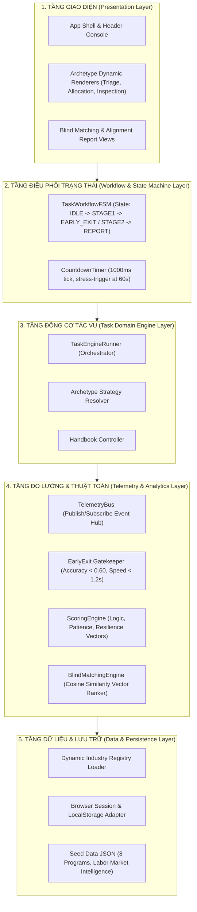
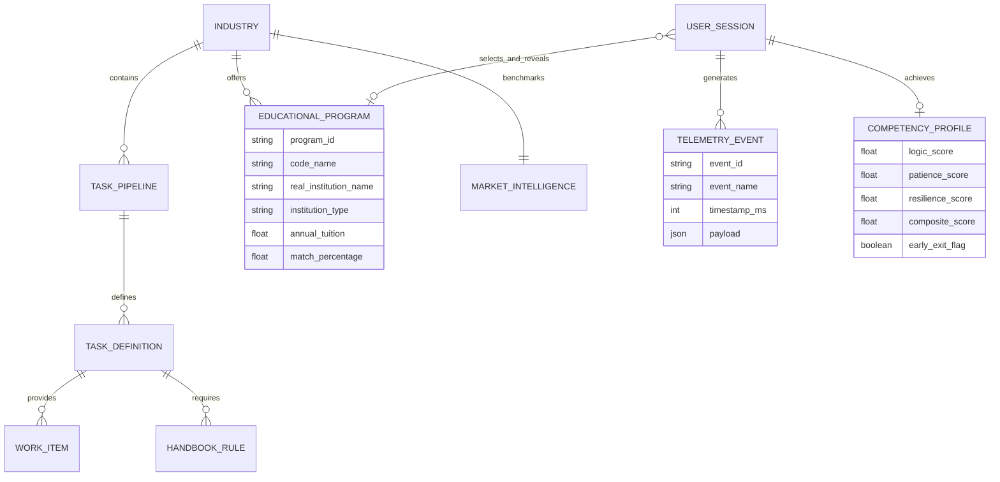
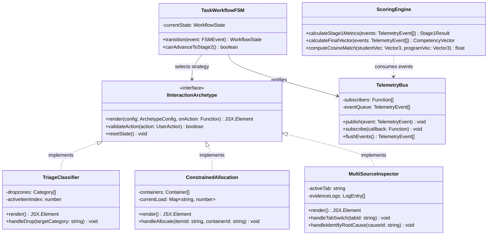
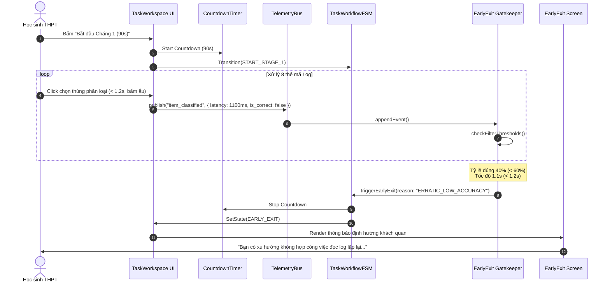
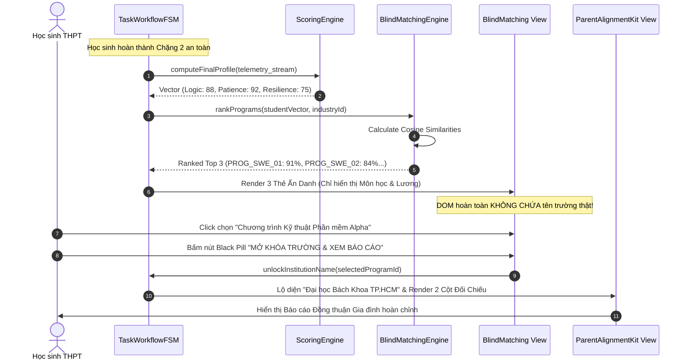

# TÀI LIỆU THIẾT KẾ PHẦN MỀM (SOFTWARE DESIGN DOCUMENT — SDD)
**Dự án:** LucidTask — Nền tảng Hướng nghiệp & Trải nghiệm Tác vụ Thực chứng  
**Chuẩn tài liệu:** Phỏng theo IEEE Std 1016-2009 (Software Design Descriptions)  
**Mục tiêu:** Chuyển đổi toàn diện từ "Hệ thống làm gì" (SRS) sang "Hệ thống được xây dựng như thế nào" (HLD & LLD Blueprint)  
**Phiên bản:** 1.0 (Master Technical Blueprint)  
**Tình trạng:** Khóa Kiến trúc để Tiến hành Lập trình (Ready for Code-Gen)  

---

## 1. Tổng Quan Kiến Trúc Cấp Cao (High-Level Design — HLD)

### 1.1. Phong Cách Kiến Trúc (Architectural Style)
LucidTask được thiết kế theo mô hình **Kiến trúc Phân tầng Đơn hướng (5-Layered Unidirectional Architecture)** kết hợp với **Động cơ Hướng Sự kiện (Event-Driven Telemetry Bus)** và **Máy trạng thái Hữu hạn (Finite State Machine - FSM)**:



### 1.2. Phân Rã Hệ Thống Thành 6 Phân Hệ Độc Lập (Subsystem Decomposition)

1. **Phân hệ Khung Ứng dụng & Điều hướng (App Shell & Routing Subsystem):** Quản lý layout chuẩn theo Design System (`#100e2f`, `#fa9000`, Roboto stack), điều hướng các màn hình mà không tải lại trang.
2. **Phân hệ Động cơ Thực thi Tác vụ (Task Runner Subsystem):** Quản lý nạp cấu hình `task.config.json`, hiển thị sổ tay nghiệp vụ và render động 1 trong 4 Archetypes tương tác.
3. **Phân hệ Trục Thu thập Hành vi (Telemetry Bus Subsystem):** Lắng nghe và đóng gói toàn bộ vi thao tác chuột (`< 50ms`), lọc nhiễu và phát hiện các mẫu hành vi vô thức.
4. **Phân hệ Quy đổi Điểm số & Khớp ngành (Scoring & Matching Subsystem):** Thực thi công thức toán học tính 3 trục năng lực, chạy bộ lọc sàng lọc sớm (Early Exit) và xếp hạng chương trình theo hàm Cosine.
5. **Phân hệ Đối soát & Hiển thị Báo cáo (Alignment & Report Subsystem):** Quản lý trạng thái lật thẻ mở khóa tên trường thật (Reveal) và kết xuất bố cục 2 cột hỗ trợ in ấn A4.
6. **Phân hệ Kho Lưu trữ & Trạng thái Cục bộ (Persistence Subsystem):** Đảm bảo tính bền vững của phiên làm việc, chống mất dữ liệu khi người dùng vô tình f5 trang.

---

## 2. Thiết Kế Dữ Liệu & Lược Đồ Bộ Nhớ (Database & Data Design)

Vì LucidTask vận hành theo mô hình Client-side Tinh gọn cho MVP, cơ sở dữ liệu được thiết kế dưới dạng **Cơ sở Dữ liệu Tài liệu Cục bộ (Normalized Document Store in LocalStorage / SessionState)**:

### 2.1. Sơ Đồ Thực Thể - Quan Hệ (Entity-Relationship Diagram — ERD)



### 2.2. Lược Đồ Lưu Trữ Cục Bộ (LocalStorage & Session State Schema)

```typescript
// Cấu trúc State Tree lưu trong LocalStorage dưới key: "LUCIDTASK_SESSION_STATE_V1"
export interface LucidTaskLocalDatabase {
  session_meta: {
    session_id: string;               // UUID ngẫu nhiên (VD: "sess_9821a-4f")
    created_at: string;               // ISO 8601
    current_status: "IDLE" | "STAGE_1" | "EARLY_EXIT" | "STAGE_2" | "MATCHING" | "REPORT_READY";
    selected_industry_id: string;
    secondary_industry_id?: string;   // Dùng khi kích hoạt đối chiếu chéo 2 ngành
  };

  telemetry_lake: Array<{
    event_id: string;
    stage_level: 1 | 2;
    timestamp_ms: number;
    event_name: string;
    payload: Record<string, any>;
  }>;

  computed_evaluation: {
    stage1_metrics?: {
      accuracy: number;
      avg_action_speed_sec: number;
      early_exit_triggered: boolean;
    };
    final_competency?: {
      logic: number;                  // 0 - 100
      patience: number;               // 0 - 100
      resilience: number;             // 0 - 100
      total_composite: number;
    };
    blind_matching_results?: Array<{
      program_id: string;
      match_score: number;
      is_selected: boolean;
      is_revealed: boolean;
    }>;
  };
}
```

---

## 3. Thiết Kế Chi Tiết Mức Thành Phần (Low-Level Design — LLD)

### 3.1. Biểu Đồ Lớp & Giao Diện Hướng Đối Tượng (Class & Interface Diagram)

Toàn bộ hệ thống áp dụng nguyên lý **SOLID**: Các Archetype tương tác tuân theo **Strategy Pattern**, Telemetry Bus tuân theo **Observer Pattern**:



---

### 3.2. Biểu Đồ Tuần Tự 1: Thực Thi Chặng 1 & Kích Hoạt Sàng Lọc Sớm (Early Exit Sequence)

Biểu đồ này mô tả chính xác cách hệ thống phát hiện học sinh thao tác ẩu và ngắt luồng văn minh:



---

### 3.3. Biểu Đồ Tuần Tự 2: Ghép Nối Ẩn Danh & Mở Khóa Tên Trường (Blind Matching & Reveal Sequence)

Biểu đồ mô tả luồng bảo vệ tính bảo mật danh tính trường học cho đến khi học sinh chọn chương trình:



---

## 4. Chứng Thực Thiết Kế Bằng Walkthrough (Desk Check & Logic Walkthrough)

Để xác nhận thiết kế không có lỗi logic trước khi bắt tay vào code, nhóm tiến hành rà soát trên 2 kịch bản dữ liệu thực tế (Dry-run with Seed Data):

### Kịch bản Chứng thực 1: Học sinh Nguyễn Văn A (Thiên hướng Vội vã / Bấm Ẩu)
1. **Dữ liệu nạp:** Khởi tạo ngành `IND_TECH_SW`. Nạp `stage1_task.json`.
2. **Hành vi thao tác:** Học sinh không mở sổ tay (`handbook_duration = 0ms`). Xử lý 8 thẻ log với thời gian: `[0.9s, 1.1s, 0.8s, 1.2s, 1.0s, 0.9s, 1.1s, 0.8s]`. Kết quả đúng 3/8 thẻ.
3. **Kiểm tra Gatekeeper:**
   - $\text{Accuracy} = \frac{3}{8} = 37.5\% < 60\%$ (Thỏa điều kiện lọc).
   - $\text{AvgSpeed} = 0.975\text{s} < 1.2\text{s}$ (Thỏa điều kiện lọc).
4. **Kết quả FSM:** Chuyển chính xác sang `EARLY_EXIT`. Không có memory leak, timer dừng ở 01:12. Không kích hoạt Chặng 2. **$\implies$ ĐẠT CHUẨN THIẾT KẾ.**

### Kịch bản Chứng thực 2: Học sinh Trần Thị B (Thiên hướng Cẩn trọng / Bền bỉ)
1. **Chặng 1:** Mở sổ tay đọc 18 giây. Xử lý 8 thẻ log đúng 8/8 thẻ. Tốc độ trung bình 4.2s/thẻ.
2. **Chuyển Chặng 2:** FSM chuyển sang Chặng 2 trong 450ms.
3. **Chặng 2:** Gặp sự cố treo cổng thanh toán. Học sinh chuyển Tab 1 $\rightarrow$ Tab 2 $\rightarrow$ Tab 3 (ghi nhận 3 lần `tab_switched`). Phát hiện dòng lỗi SSL Deploy 2.1, chọn phương án Rollback bản 2.0.
4. **Tính toán Điểm:**
   - $S_{\text{Logic}} = (0.5 \times 1.0 + 0.35 \times 1.0 + 0.15 \times 1.0) \times 100 = 100$.
   - $S_{\text{Patience}} = (0.4 \times 1.0 + 0.35 \times 0.8 + 0.25 \times 0.9) \times 100 = 90.5$.
5. **So khớp Chương trình:** Vector sinh viên $(1.0, 0.905, 0.75)$ so khớp với `PROG_SWE_01` (Bách Khoa: weights $0.45, 0.35, 0.20$) ra điểm Cosine $\text{Match\_Score} = 92.4\%$.
6. **Mở khóa & Xuất PDF:** Thẻ lộ diện tên trường Bách Khoa. Báo cáo 2 cột hiển thị đầy đủ bảng chi phí rủi ro 185 triệu. Bấm Ctrl+P render đúng layout 1 trang A4. **$\implies$ ĐẠT CHUẨN THIẾT KẾ.**

---

## 5. Bảng Đánh Giá Độ Kết Dính (Cohesion) & Độ Ghép Nối (Coupling)

| Thành phần Module | Độ Kết Dính (Cohesion) | Độ Ghép Nối (Coupling) | Đánh giá Kiến trúc |
| :--- | :--- | :--- | :--- |
| **`TelemetryBus.ts`** | **Functional Cohesion:** Chỉ làm duy nhất 1 việc: thu thập, chuẩn hóa và phân phối sự kiện thao tác. | **Loose Coupling:** Không biết gì về giao diện React hay dữ liệu ngành học. | **Xuất sắc:** Có thể tái sử dụng cho bất kỳ dự án đo lường hành vi nào khác. |
| **`Archetype Renderers`** | **Sequential Cohesion:** Nhận config $\rightarrow$ render thẻ $\rightarrow$ bắt tương tác $\rightarrow$ trả về action chuẩn. | **Decoupled:** Tách rời 100% khỏi nội dung nghiệp vụ (hoàn toàn hướng schema). | **Xuất sắc:** Thêm ngành mới không bao giờ phải sửa code renderer. |
| **`ScoringEngine.ts`** | **Communicational Cohesion:** Tiếp nhận stream sự kiện để tính toán các vector năng lực liên quan. | **Low Coupling:** Chỉ phụ thuộc vào cấu trúc `TelemetryEvent`, không phụ thuộc vào UI State. | **Xuất sắc:** Dễ dàng viết Unit test kiểm thử độc lập. |

