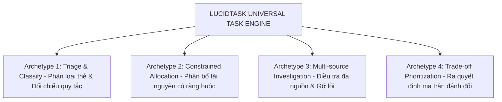

# KIẾN TRÚC ĐỘNG CƠ TÁC VỤ & KHẢ NĂNG MỞ RỘNG (Task_Engine_Architecture.md)
**Dự án:** LucidTask — Nền tảng Hướng nghiệp & Trải nghiệm Tác vụ Thực chứng  
**Mục tiêu:** Thiết lập cấu trúc module hóa (Modular & Schema-driven) cho phép bổ sung hàng chục ngành nghề mới mà KHÔNG cần viết lại code giao diện hay logic cốt lõi  
**Phiên bản:** 1.0  
**Tình trạng:** Khóa Kiến trúc Kỹ thuật (Technical Architecture Baseline)  

---

## 1. Vấn đề Cốt lõi & Triết lý Kiến trúc

### 1.1. Bẫy "Hard-code" Thường gặp
Nếu mỗi ngành nghề (IT, Logistics, Y tế, Tài chính, Marketing...) đều được lập trình bằng một giao diện riêng biệt với logic chấm điểm riêng:
- Mã nguồn sẽ nhanh chóng bị phình to (Monolithic Spaghetti).
- Khi thêm ngành mới, lập trình viên phải code lại từ đầu màn hình làm việc, đồng hồ, sổ tay, bộ thu telemetry.
- Bất kỳ thay đổi nào về cách tính điểm cũng sẽ làm vỡ các ngành cũ.

### 1.2. Giải pháp của LucidTask: Kiến trúc Hướng Dữ liệu & Nguyên tử Tương tác (Schema-Driven & Primitive-Based)
Thay vì code giao diện cứng cho từng nghề, LucidTask xây dựng một **Task Execution Engine (Động cơ Thực thi Tác vụ)** tổng quát:
1. **Tách rời 100% Nội dung khỏi Động cơ:** Mọi tác vụ của bất kỳ ngành nào đều được định nghĩa thông qua một file cấu hình chuẩn (`task.config.json`).
2. **Quy về 4 Nguyên tử Tương tác Cốt lõi (Universal Interaction Archetypes):** Mọi công việc văn phòng/chuyên môn trên thực tế dù đa dạng đến đâu cũng quy về 4 dạng tương tác cơ bản trên màn hình.
3. **Động cơ Telemetry Chuẩn hóa (Universal Telemetry Bus):** Bộ đo hành vi độc lập hoàn toàn với ngữ cảnh của ngành, chỉ ghi nhận các tín hiệu trừu tượng (nhịp thao tác, độ trễ, số lần sửa đổi, vi phạm ràng buộc).

---

## 2. Bốn Nguyên tử Tương tác Cốt lõi (The 4 Universal Interaction Archetypes)

Nhờ 4 Archetype này, nhóm có thể mô phỏng hầu như mọi ngành nghề trong xã hội:



### Archetype 1: `TRIAGE_AND_CLASSIFY` (Phân loại & Gắn thẻ theo Quy tắc)
- **Bản chất tương tác:** Một dòng các thẻ thông tin xuất hiện, người dùng phải đọc quy tắc và kéo thả/bấm nút để đưa thẻ vào các thùng phân loại phù hợp dưới áp lực thời gian.
- **Ứng dụng thực tế cho các ngành:**
  - *Công nghệ phần mềm:* Phân loại Log lỗi (P1, P2, P3).
  - *Y tế / Cấp cứu:* Sàng lọc bệnh nhân phân luồng (Triage đỏ/vàng/xanh).
  - *Ngân hàng / Tín dụng:* Phân loại hồ sơ vay (Đủ điều kiện, Cần bổ sung, Từ chối).
  - *Dịch vụ Khách hàng:* Phân loại khiếu nại (Gấp, Bình thường, Chuyển cấp trên).

### Archetype 2: `CONSTRAINED_ALLOCATION` (Cân bằng & Phân bổ Tài nguyên có Ràng buộc)
- **Bản chất tương tác:** Người dùng có một tập hợp các đối tượng (kiện hàng, nhân sự, ngân sách) và các vật chứa (xe tải, ca trực, chiến dịch). Mỗi vật chứa có giới hạn cứng (sức chứa, thời gian, ngân sách) không được vượt quá.
- **Ứng dụng thực tế cho các ngành:**
  - *Logistics:* Cân bằng tải trọng xe tải, tối ưu thể tích container.
  - *Quản trị Nhân sự:* Xếp lịch trực bệnh viện/khách sạn đảm bảo không ai làm quá 8 tiếng.
  - *Marketing:* Phân bổ 50 triệu ngân sách vào 4 kênh (Facebook, TikTok, Google, KOL) theo KPI.

### Archetype 3: `MULTI_SOURCE_INVESTIGATION` (Điều tra Đa nguồn & Tìm Nguyên nhân Gốc)
- **Bản chất tương tác:** Giao diện chia nhiều Tab dữ liệu (Báo cáo, Nhật ký, Bảng tính). Người dùng phải xâu chuỗi thông tin giữa các Tab để tìm ra điểm bất thường (Anomaly/Root-cause) và bấm nút khắc phục.
- **Ứng dụng thực tế cho các ngành:**
  - *Kỹ thuật phần mềm:* Debug lỗi cổng thanh toán Flash-Sale.
  - *Kế toán / Kiểm toán:* Đối chiếu sổ phụ ngân hàng với hóa đơn GTGT để tìm gian lận.
  - *Báo chí / Điều tra:* Đối chiếu lời khai nhân chứng với bằng chứng hình ảnh.

### Archetype 4: `TRADE_OFF_PRIORITIZATION` (Đánh đổi Chiến lược & Ra Quyết định Ma trận)
- **Bản chất tương tác:** Người dùng đứng trước một khủng hoảng mà không có giải pháp hoàn hảo, buộc phải đánh đổi (ví dụ: hy sinh chi phí để cứu thời gian, hoặc hy sinh tính năng để cứu deadline).
- **Ứng dụng thực tế cho các ngành:**
  - *Quản lý Dự án (PM):* Cắt giảm phạm vi sản phẩm trước ngày ra mắt.
  - *Kinh doanh Quốc tế:* Chọn phương án vận chuyển hàng không đắt đỏ hay đường biển chậm trễ.

---

### 2.5. Kiến Trúc Tách Rời "Headless Engine Hook" & "Diegetic UI Skins" (Chống Phình To & Trùng Lặp Mã)

Để nâng cấp giao diện sang phong cách **Game Hóa Nhập Vai (Diegetic UI)** theo [docs/roadmap/gamification_diegetic_ui_rfc.md](file:///Users/phamkhanh/Documents/2026.1/DMST/LucidTask/docs/roadmap/gamification_diegetic_ui_rfc.md) mà **không làm trùng lặp mã nguồn hoặc phá vỡ các bài kiểm thử hiện có**, hệ thống áp dụng mẫu thiết kế **Headless Hook + Pluggable View Skins**:

1. **Tầng Headless Logic (`useTriageEngine`, `useTradeOffBars`):**
   - Quản lý toàn bộ vòng đời câu hỏi, bộ đếm thời gian, độ trễ từng thao tác (`latency_ms`), trạng thái 3 thanh chỉ số đánh đổi (Chất lượng, Hài lòng Sếp/Khách, Tinh thần Giờ G) và phát sự kiện chuẩn vào `TelemetryBus`.
2. **Tầng Giao Diện Cắm Rút (Diegetic UI Skins):**
   - **`PAPERS_PLEASE_DOCKET`:** Giao diện bàn kiểm duyệt hồ sơ/đơn hàng kèm bảng quy định SOP 3 dòng ghim cố định và 2 con dấu đóng trực tiếp (hoặc phím tắt `A`/`D`).
   - **`REIGNS_CARD_SWIPE`:** Giao diện thẻ quyết định quẹt trái/phải làm biến động tức thì 3 thanh chỉ số Trade-off Bars trên đỉnh màn hình.
   - **`WORK_CHAT_WAR_ROOM`:** Giao diện khung chat công việc (kiểu Zalo/Slack) nơi tin nhắn từ Sếp và Khách hàng nhảy liên tục theo thời gian thực kết hợp bảng đối soát dữ liệu.

---

## 3. Hợp đồng Định nghĩa Tác vụ Chuẩn (Task Configuration Schema)

Mỗi ngành nghề mới chỉ cần tạo một file JSON tuân theo schema dưới đây:

```typescript
export type InteractionArchetype = 
  | "TRIAGE_AND_CLASSIFY"
  | "CONSTRAINED_ALLOCATION"
  | "MULTI_SOURCE_INVESTIGATION"
  | "TRADE_OFF_PRIORITIZATION";

export interface TaskDefinitionSchema {
  metadata: {
    task_id: string;                  // VD: "MED_TRIAGE_01"
    industry_id: string;              // VD: "IND_HEALTHCARE"
    stage_level: 1 | 2 | 3;           // 1: Sơ tuyển ma sát, 2: Cốt lõi, 3: Nâng cao
    title: string;
    role_title: string;               // Tên vai trò nhập vai (VD: "Điều dưỡng Trưởng Ca Trực")
    time_limit_sec: number;
  };

  // Sổ tay quy tắc hiển thị ở Drawer (đọc hiểu trong 15-30s)
  handbook: {
    quick_summary: string;
    rules: Array<{
      code: string;                   // VD: "RULE_RED"
      label: string;
      description: string;
      badge_color: string;
    }>;
  };

  // Khai báo dạng tương tác của Task
  interaction: {
    archetype: InteractionArchetype;
    
    // Cấu hình cụ thể cho từng Archetype (Dynamic Props)
    archetype_config: {
      // Dùng cho TRIAGE: Danh sách các thùng phân loại
      categories?: Array<{ id: string; label: string; max_items?: number }>;
      
      // Dùng cho CONSTRAINED_ALLOCATION: Ràng buộc vật chứa
      containers?: Array<{ id: string; label: string; capacity_limit: number }>;
      
      // Dùng cho INVESTIGATION: Các Tab dữ liệu
      data_sources?: Array<{ tab_id: string; tab_label: string; content_type: "table" | "log" | "text" }>;
    };

    // Danh sách các đối tượng dữ liệu phát sinh trong bài test
    work_items: Array<{
      item_id: string;
      title: string;
      content_snippet: string;
      details?: Record<string, any>;
      correct_target_id: string;      // Đáp án chuẩn để đối chiếu tính điểm
      is_noise?: boolean;             // Cờ đánh dấu thông tin gây nhiễu
      reveal_at_sec?: number;         // Xuất hiện ở giây thứ bao nhiêu (tạo nhịp độ dồn dập)
    }>;
  };

  // Quy chuẩn Sàng lọc Sớm (Chỉ áp dụng cho Stage 1)
  filter_gatekeeper?: {
    min_accuracy: number;             // Ngưỡng chính xác tối thiểu (VD: 0.65)
    max_erratic_speed_sec: number;    // Bấm nhanh hơn mức này bị coi là đoán mò
    early_exit_feedback: {
      headline: string;
      friction_reason: string;
      alternative_industries: string[];
    };
  };

  // Ma trận Trọng số Năng lực của Task này
  scoring_weights: {
    logic_weight: number;
    patience_weight: number;
    resilience_weight: number;
  };
}
```

---

## 4. Cấu trúc Thư mục Module hóa (Plug-and-Play Directory Layout)

Hệ sinh thái mã nguồn được tổ chức sao cho việc thêm ngành mới chỉ là việc tạo thêm 1 thư mục dữ liệu mà không đụng chạm vào thư mục `engine/`:

```
src/
├── engine/                           # BỘ ĐỘNG CƠ CỐT LÕI (BẤT BIẾN - DO NOT TOUCH)
│   ├── TaskEngineRunner.tsx          # Component Master điều phối thời gian, sổ tay, stepper
│   ├── TelemetryBus.ts               # Bộ thu thập và phát hiện thao tác vô thức
│   ├── ScoringEngine.ts              # Thuật toán chuyển đổi sự kiện thành điểm số 3 trục
│   └── archetypes/                   # 4 MẪU TƯƠNG TÁC DÙNG CHUNG
│       ├── TriageClassifier.tsx      # Renderer cho Archetype 1
│       ├── ConstrainedAllocation.tsx # Renderer cho Archetype 2
│       ├── MultiSourceInspector.tsx  # Renderer cho Archetype 3
│       └── TradeoffMatrix.tsx        # Renderer cho Archetype 4
│
├── registry/                         # BỘ ĐĂNG KÝ NGÀNH NGHỀ (PLUG-IN REGISTRY)
│   ├── index.ts                      # Nạp toàn bộ các ngành tự động (Dynamic Loader)
│   │
│   ├── software_engineering/         # MODULE NGÀNH 1: KỸ THUẬT PHẦN MỀM
│   │   ├── industry.json             # Thông tin chung & Dữ liệu thị trường
│   │   ├── programs.json             # 4 chương trình đào tạo cho Blind Matching
│   │   ├── stage1_task.json          # Config Task 1 (Dùng Archetype 1: Triage Log)
│   │   └── stage2_task.json          # Config Task 2 (Dùng Archetype 3: Multi-source Debug)
│   │
│   ├── supply_chain_logistics/       # MODULE NGÀNH 2: LOGISTICS
│   │   ├── industry.json
│   │   ├── programs.json
│   │   ├── stage1_task.json          # Config Task 1 (Dùng Archetype 2: Allocation Tải)
│   │   └── stage2_task.json          # Config Task 2 (Dùng Archetype 4: Tradeoff Lộ trình)
│   │
│   └── healthcare_nursing/           # MODULE NGÀNH MỚI (Ví dụ: Y TẾ ĐIỀU DƯỠNG)
│       ├── industry.json             # Chỉ cần copy mẫu và điền dữ liệu
│       ├── programs.json
│       ├── stage1_task.json          # Dùng lại Archetype 1 (Phân luồng bệnh nhân)
│       └── stage2_task.json          # Dùng lại Archetype 2 (Xếp lịch ca cấp cứu)
```

---

## 5. Quy Chuẩn 5+5 Khi Thiết Kế & Thêm Một Ngành Nghề Mới (Workplace-to-Game Authoring Standard)

Để mọi ngành nghề mới thêm vào LucidTask đều đạt sức hút của một **Game Mô phỏng Nghề nghiệp Thực tế** (như hình mẫu *Nợ Có Ơi* — xem chi tiết tại [docs/roadmap/gamification_diegetic_ui_rfc.md](file:///Users/phamkhanh/Documents/2026.1/DMST/LucidTask/docs/roadmap/gamification_diegetic_ui_rfc.md#L98-L185)) và tuyệt đối **không biến thành bài thi trắc nghiệm bọc vỏ giao diện**, người thiết kế nội dung phải tuân thủ quy trình chuẩn hóa sau:

### 5.1. Năm Điều Kiện Chuyển Đổi Bắt Buộc Khi Thiết Kế Tác Vụ Ngành Mới
1. **Biến tính mơ hồ thành "Vòng lặp phản hồi khép kín" theo 2 Thái cực Ngành:**
   - *Ngành có luật đúng/sai rạch ròi (Kế toán, Kiểm toán, Pháp chế, Logistics tải trọng, Soát lỗi dữ liệu):* Thiết kế cơ chế kiểm tra khớp số học hoặc quy tắc cứng ngay lập tức (Tổng Nợ = Tổng Có, dòng báo đỏ `Lệch ...` khi chưa cân).
   - *Ngành có kết quả mở/mơ hồ (Marketing, Truyền thông, Thiết kế, Quản trị):* Lượng hóa hệ quả thành các **chỉ số xung đột trực tiếp** (*Ngân sách – Lượng khách – Uy tín thương hiệu*) để mỗi thao tác điều chỉnh đều làm thanh này tăng và thanh kia tụt ngay trước mắt.
2. **Nén thời gian & Cắt bỏ toàn bộ "thời gian chết" (*Time Compression*):**
   - Thu gọn chu kỳ công việc 1 tuần / 1 tháng ngoài đời vào đúng **3–5 phút** ca trực; cắt bỏ mọi thủ tục hành chính rườm rà, chỉ giữ lại các điểm ra quyết định có ma sát cao nhất.
3. **Thao tác Kiến tạo Chủ động (*Active Construction*) — Cấm Chọn đáp án Thụ động:**
   - **Bước 1 (Soi chứng từ chạm dòng lỗi thật — *Tactile Authenticity*):** Đặt thẳng tờ Hóa đơn, Đơn đặt hàng, Phiếu xuất kho hoặc Hợp đồng gồm 5–8 dòng lên bàn. Chỉ có 1–2 dòng thực sự gài bẫy (`is_flawed: true`, ví dụ: *"Giảm 5% so với bảng giá — chưa có duyệt của trưởng phòng"*, lệch số lượng thực giao, cộng nhầm tổng). Chạm trúng dòng sai mới bắt được lỗi; chạm vào dòng hợp lệ là bắt nhầm; chứng từ sạch hoàn toàn thì bấm `Hợp lệ ✓`.
   - **Bước 2 (Lắp ráp & Cân bằng khay số liệu/chứng cứ):** Không dùng nút Radio A/B/C/D viết sẵn lời giải. Người chơi phải tự gắp thẻ nghiệp vụ và gắn số liệu/bằng chứng vào 2 khay đối ứng cho đến khi triệt tiêu dòng báo đỏ `Lệch ...` về `0`.
4. **Giữ "Điểm cân bằng trừu tượng hóa" (*Abstraction Sweet Spot*) & Dẫn nhập Bình dân hóa (*Micro-scaffolding*):**
   - Dùng ví dụ bình dân kiểu *"Kế toán vỉa hè"* (chuyện mua xe đẩy bán trà sữa, chuyện thuê ca sĩ hội trường) để giải thích khái niệm chuyên môn trong 15 giây; không nhồi nhét thông tư hay cú pháp code hàn lâm nhưng giữ nguyên 100% cấu trúc tư duy của nghề.
5. **Thiết kế Nhân cách hóa Công sở (`🛡️ Uy tín` vs `❤️ Thiện cảm`, `Sai sót ẩn`) & "Điểm chốt giải tỏa" (*Closure & Catharsis*):**
   - Hồ sơ được mang tới bởi các đồng nghiệp có cá tính (*Cô Ba*, *Bé Mít*, *Bé Na*, *Sếp Tài*). Làm đúng nguyên tắc khi đồng nghiệp xin "lách luật" sẽ tăng **🛡️ Uy tín** nhưng giảm **❤️ Thiện cảm**; nể nang cho qua sẽ giữ được **❤️ Thiện cảm** nhưng tạo ra **"Sai sót ẩn" (*Latent Error*)** bị khui ra ở cuối ca.
   - Cuối mỗi ca phải có nghi thức **Khóa sổ / Chốt bảng cân đối khớp từng đồng (`A = B ✓`)** để tạo cảm giác giải tỏa hoàn tất.

### 5.2. Quy trình 3 Bước Kỹ Thuật để Đăng Ký Ngành Mới vào Hệ Thống
1. **Bước 1 (Xác định Thái cực & Archetype):** Chọn cơ chế tương tác phù hợp với thái cực của ngành (`TRIAGE_AND_CLASSIFY`, `CONSTRAINED_ALLOCATION`, `MULTI_SOURCE_INVESTIGATION`, `TRADE_OFF_PRIORITIZATION`).
2. **Bước 2 (Soạn File JSON theo Checklist 5+5):** Điền quy tắc SOP 3 dòng, danh sách chứng từ đa dòng (`document_rows` có đánh dấu `is_flawed`), lời thoại đồng nghiệp (`npc_name`, `npc_quote`) và cấu hình khay cân bằng vào `stage1_task.json` và `stage2_task.json`.
3. **Bước 3 (Đăng ký vào Registry):** Khai báo thư mục mới vào `src/registry/index.ts` để hệ thống tự động nạp lên giao diện, thu thập `TelemetryBus` và quy đổi sang khung **Big Five (OCEAN) + Holland RIASEC**.

